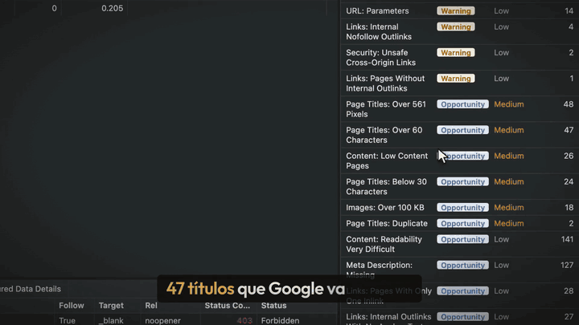
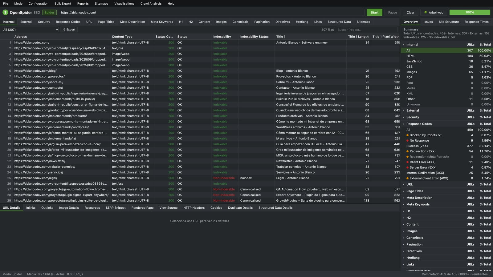
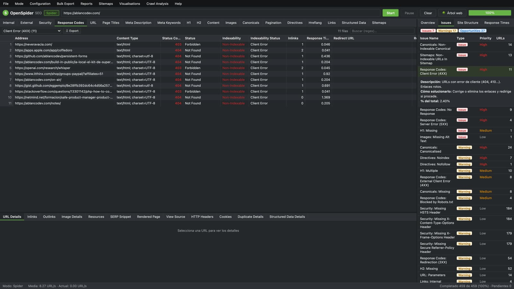
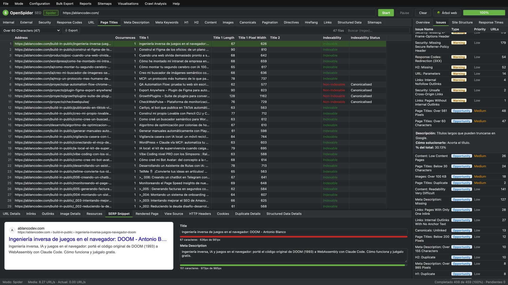
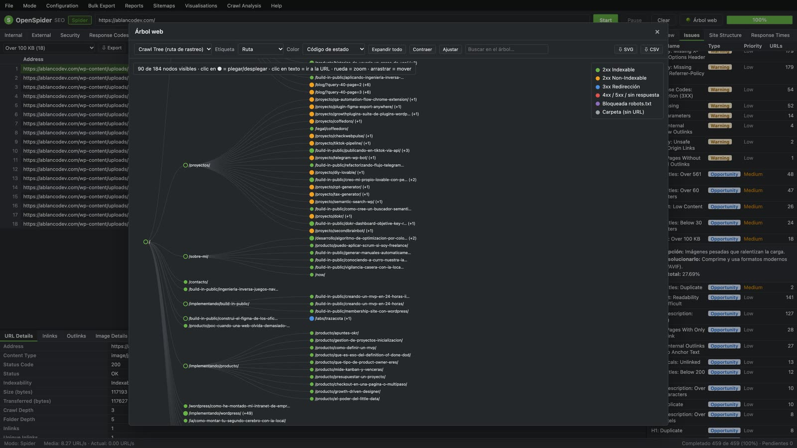

# OpenSpider SEO

**OpenSpider** es un rastreador SEO (*crawler*) de código abierto que funciona en el navegador. Recorre un sitio web, analiza cada URL y detecta problemas técnicos de SEO: errores, redirecciones, títulos y descripciones, encabezados, canonicals, hreflang, contenido duplicado, enlazado interno, seguridad, datos estructurados y mucho más.

Está hecho con HTML, CSS y JavaScript sin dependencias, más un pequeño proxy en PHP para poder descargar páginas de cualquier dominio.



## Capturas

| Rastreo | Incidencias priorizadas |
|---|---|
|  |  |
| **Vista previa del snippet en Google** | **Árbol web** |
|  |  |

## Características

- **Modo Spider**: rastrea un sitio completo desde una URL de inicio siguiendo enlaces, respetando `robots.txt`.
- **Modo List**: analiza solo una lista de URLs (pegada o desde `.txt` / `.csv`).
- **Más de 20 pestañas de análisis** con más de 150 filtros: Internal, External, Security, Response Codes, URL, Page Titles, Meta Description, Meta Keywords, H1, H2, Content, Images, Canonicals, Pagination, Directives, Hreflang, Links, Structured Data, Sitemaps, Custom Search y Custom Extraction.
- **Panel de incidencias** clasificadas como *Issue*, *Warning* u *Opportunity*, con prioridad, descripción y cómo solucionarlas. Exportable a CSV.
- **Análisis del rastreo**: Link Score (PageRank interno), casi duplicados (MinHash + LSH), duplicados exactos, validación de hreflang (enlaces de retorno, códigos ISO, x-default), páginas huérfanas.
- **Árbol web** interactivo por ruta de rastreo o por carpetas: plegable, buscable, coloreable por estado, indexabilidad, profundidad, Link Score o tiempo de respuesta. Exporta a SVG y CSV.
- **Diagramas de fuerzas** del rastreo y de la estructura de directorios.
- **Detalle de cada URL**: datos completos, inlinks, outlinks, imágenes, recursos, vista previa del snippet en Google (editable, con medición en píxeles), página renderizada, código fuente, cabeceras HTTP, cookies, duplicados y JSON-LD.
- **Informes**: resumen del rastreo, cadenas de redirección, cadenas de canonical, resumen SERP, páginas huérfanas, tiempos de respuesta y probador de `robots.txt`.
- **Exportaciones masivas** a CSV: todos los inlinks, outlinks, anchors, imágenes, enlaces a 3xx/4xx/5xx, contenido mixto, canonicals, hreflang, datos estructurados…
- **Generador de sitemaps** XML y de imágenes.
- **Búsqueda personalizada** (texto o regex, contiene / no contiene) y **extracción personalizada** (selectores CSS, XPath o regex).
- **Configuración completa**: hilos, retardo, límites de URLs y profundidad, include/exclude con regex, reescritura de URLs, user-agent, cabeceras HTTP, autenticación HTTP, sitemaps y umbrales de todos los filtros.
- **Guardar y abrir rastreos** (`.ospider.json`), tabla virtualizada para miles de filas, menú contextual con herramientas externas y tema claro/oscuro.

## Requisitos

- Un servidor web con **PHP 7.4+** y la extensión **cURL** (por ejemplo XAMPP, MAMP, Laragon o `php -S`).
- Un navegador moderno (Chrome, Edge, Firefox o Safari).

## Instalación

```bash
git clone https://github.com/ablancodev/openspider.git
cd openspider
php -S localhost:8080
```

Abre `http://localhost:8080/` en el navegador.

Con XAMPP o similar, copia la carpeta dentro de `htdocs` y abre `http://localhost/openspider/`.

### ¿Te lo monto yo?

¿Te parece una herramienta que te vendría genial, pero eso de clonar repos y levantar servidores te suena a chino? Sin problema: [escríbeme](https://ablancodev.com/contacto/) y lo dejo funcionando para ti o para tu empresa. 🙂

## Uso rápido

1. Escribe la URL del sitio y pulsa **Start**.
2. Navega por las pestañas y usa el desplegable de filtros (o el panel **Overview** de la derecha).
3. Revisa la pestaña **Issues** del panel derecho para ver los problemas priorizados.
4. Selecciona una URL para ver sus detalles en el panel inferior.
5. Al terminar se ejecuta el análisis del rastreo (también disponible en *Crawl Analysis → Start*).
6. Exporta lo que necesites desde **Export**, *Bulk Export*, *Reports* o *Sitemaps*.

Atajos: `⌘/Ctrl + S` guardar rastreo · `⌘/Ctrl + O` abrir · `↑ / ↓` navegar · doble clic abre la URL · clic derecho para más opciones.

## Arquitectura

| Archivo | Función |
|---|---|
| `api.php` | Proxy cURL: descarga la URL y devuelve estado, cabeceras, tiempos y cuerpo HTML. No sigue redirecciones automáticamente (cada salto se registra). |
| `assets/js/crawler.js` | Motor de rastreo: cola BFS, hilos concurrentes, robots.txt, sitemaps, límites, reescritura de URLs, persistencia. |
| `assets/js/parser.js` | Extracción de datos SEO con `DOMParser`. |
| `assets/js/robots.js` | Intérprete de `robots.txt` (coincidencia más larga, comodines `*` y `$`). |
| `assets/js/analysis.js` | Inlinks/outlinks, duplicados, Link Score, casi duplicados, hreflang. |
| `assets/js/tabs.js` | Pestañas, columnas, filtros e incidencias. |
| `assets/js/grid.js` | Tabla virtualizada con ordenación y columnas redimensionables. |
| `assets/js/tree.js` | Árbol web interactivo. |
| `assets/js/viz.js` | Diagramas de fuerzas. |
| `assets/js/reports.js` | Informes, exportaciones masivas y sitemaps. |
| `assets/js/config.js` | Ventana de configuración. |
| `assets/js/app.js` | Interfaz: menús, paneles y eventos. |

## Seguridad

`api.php` es un proxy HTTP. Desde `localhost` funciona sin restricciones. Desde fuera, por defecto funciona en **modo demo** (`$remoteMode = 'demo'`), pensado para publicarlo en Internet:

- Solo descarga URLs de hosts con IP pública (bloquea `localhost`, redes privadas, link-local/metadatos, etc.) y fija la IP validada para evitar *DNS rebinding*.
- Solo puertos 80 y 443, solo `http`/`https`, sin credenciales en la URL.
- Verifica los certificados SSL, limita el tamaño (5 MB) y el timeout (20 s).
- Máximo de peticiones por minuto e IP (`$demoRateMin`); el rastreador espera y reintenta si se alcanza.

Pon `$remoteMode = 'off'` para aceptar solo `localhost`. `'open'` quita todas las restricciones (proxy abierto, no lo uses en un servidor público).

Rastrea solo sitios que tengas permiso para analizar y usa velocidades razonables para no sobrecargar servidores ajenos.

## Limitaciones

- No ejecuta JavaScript: las páginas que generan su contenido en el cliente se analizan tal como las sirve el servidor.
- Los datos viven en la memoria del navegador: recomendado hasta unas decenas de miles de URLs.
- El ancho en píxeles de títulos y descripciones es una aproximación.

## Hoja de ruta

- Renderizado JavaScript con un navegador headless.
- Integraciones con Google Search Console, Google Analytics y PageSpeed Insights.
- Comparación entre rastreos.
- Rastreos programados.
